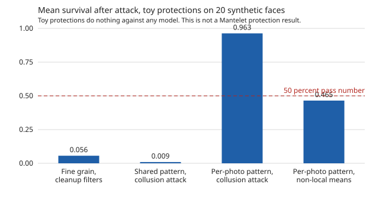
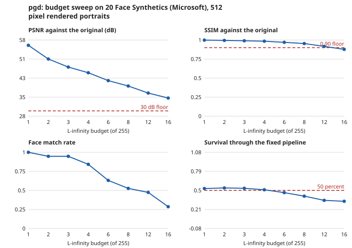
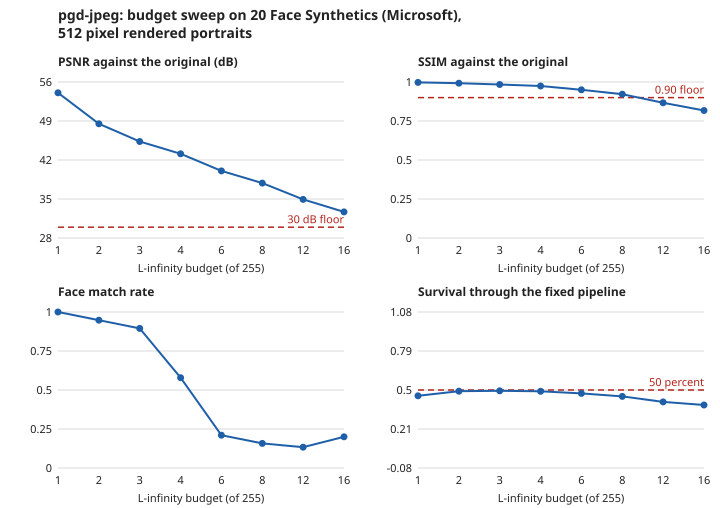

# Results

This page holds the measured results of Mantelet. It says what has been measured, what each result does and does not show, and which results are still missing. The first protection has been run on 20 synthetic faces and did not pass Gate 1. No protection has been tested on real people's photos, and none works against an editing model.

## Status

| Result | State |
|---|---|
| Measuring tools and red team attacks tested on toy protections | Measured. Shown below |
| Baseline on synthetic faces | Not published. Waits for the owner's run |
| First protection on 20 synthetic faces (Gate 1) | Run. Not passed by either kind. Shown below |
| Human perception study | Not started |
| Real editing pipeline (Gate 2) | Not started |
| Attacker levels and transfer to other models (Gate 3) | Not started |

## What has been measured

Seven claims in the [claims ledger](../../research/claims-ledger.md) are Measured about the toys and the measuring pieces: C-031, C-034, C-035, C-041, C-043, C-044 and C-049. Six more come from the first protection and are in the next section. The first three, with the toys, use made-up photos or 20 Face Synthetics photos. A toy protection adds a hidden pattern that does nothing against any editing model or face matcher. Toys exist so that we know the right answer and can check that the red team finds a planted weakness without breaking a sound control.

| Claim | Result | Data |
|---|---|---|
| C-031 | On made-up test photos, cleanup filters remove most of the fine toy grain at acceptable quality. The collusion attack removes a toy pattern shared by every photo and leaves one that differs per photo | Made-up photos, repeatable tests |
| C-034 | On 20 Face Synthetics photos, the red team found the planted weakness and did not break the control. No photo was left out for any toy | 20 photos, seed 0 |
| C-035 | A smooth toy pattern keeps at least 80 percent survival through the fixed pipeline at every tested crop corner. Fine toy grain keeps under 20 percent at every corner | Made-up 512 pixel photos |

### Figure: toy survival after attack

*Mean survival of the toy pattern after the red team attacks, over 20 Face Synthetics photos. Survival is 1 when nothing was removed and 0 when all of it was. The dashed line is the 50 percent pass number from the [test plan](test-plan.md). The values are the means in claim C-034. These are toy protections that do nothing against any model. This figure checks our measuring and attack tools. It is not a Mantelet protection result and says nothing about whether a real protection works.*

How to read it:

- Fine random grain is almost fully removed by cleanup filters (mean survival 0.056). This is the planted weak toy, and the tools found it.
- A pattern shared by every photo is removed by the collusion attack (0.009). This is the planted design flaw, and the tools found it.
- A pattern that differs in every photo survives the collusion attack (0.963). This is the sound control, and the tools did not break it.
- The same per-photo pattern drops to a mean of 0.465 under non-local means denoising. 6 of the 20 photos stay at 50 percent or more.

The figure shows means only. The ledger holds means and not the per-photo values, so the figure cannot show spread or error bars. We have not published per-photo data for this run.

## The first protection on 20 synthetic faces (Gate 1)

The protection is projected gradient descent against a PyTorch copy of SFace, in two kinds: `pgd` and `pgd-jpeg`, which is also tuned through JPEG. The rules for judging it were fixed in the [test plan](test-plan.md) before the run. We did not move them after seeing the numbers. The run is the owner's, on 20 Face Synthetics photos, seed 0, one face model. The budget is the largest in the sweep where every photo stays above the quality floor: 12 for `pgd` and 8 for `pgd-jpeg` (claim C-053).

**Result: neither kind passes Gate 1.** Visibility was not measured, so no result could have been a full pass.

| Number from the test plan | `pgd`, budget 12 | `pgd-jpeg`, budget 8 | Needed |
|---|---|---|---|
| Worst PSNR and SSIM, every counted photo | about 37 dB, 0.92 | about 38 dB, 0.92 | 30 dB, 0.90. Met |
| Mean survival at the centre crop | 0.348 | 0.455 | at least 0.5 |
| Photos with at least 50 percent survival at the centre crop | 1 of 20 | 3 of 20 | |
| Drop in face match through the fixed pipeline | 47.4 points | 89.5 points | at least 50 |
| Drop against attackers up to level 2 | 0.0 points | 5.0 points | at least 50 |
| Drop used for the gate, the smaller of the two | 0.0 points | 5.0 points | at least 50 |

Both kinds miss the survival number and the drop used for the gate. `pgd-jpeg` does well through the fixed pipeline alone: only 2 of 19 counted photos still match. The attackers undo it. The best result of the level 1 and level 2 attacks still matched the face on 18 of 20 photos for both kinds, and non-local means denoising alone did it on 18 of 20 (claims C-051 and C-052).

### Figure: the budget sweep

*Budget sweep over 20 Face Synthetics photos, seed 0, from `scripts/run_budget_sweep.py`. The face match is through the fixed pipeline with no attacker, against the unprotected photo, with a lost face counted as an attacker win. PSNR and SSIM show the worst photo. Survival shows the mean. At budget 16, 5 photos (`pgd`) and 9 photos (`pgd-jpeg`) fall below the quality floor and are left out of the face match, so the last point rests on fewer photos. We have not drawn per-photo distributions or error bars yet.*

How to read it:

- A larger budget lowers the face match through the pipeline, and the quality scores fall with it. For `pgd-jpeg` the face match drops from 19 of 19 photos at budget 1 to 4 of 19 at budget 6.
- Survival of the change through the fixed pipeline stays near or below 0.5 at every budget. The tuning through JPEG helps a little at budget 8 (0.453 against 0.413), and the intervals on the face match overlap (claim C-048).

### What the Gate 1 run does not show

- It is 20 synthetic faces and one face model, the one the protection was tuned against. We expect, but have not tested, that a different face model would do worse.
- The attacker may use the face match to pick the best result for each photo. A real attacker has to guess. This is the worst case rule, and it is generous to the attacker.
- Nothing here says whether the protection stops an edit. No editing model is built yet, and a face model is not an editing model.
- The numbers need only 20 photos to move a long way. A change of 2 photos moves a rate by 10 points. See the intervals in the ledger.
- The sweep and the red team script use different random starts, so they differ slightly for the same budget and seed. The gate uses the red team numbers (claim C-054).
- The test plan says what follows a "no" at Gate 1. The owner decides it. It is not decided here.

## What the toy results do not show

- They say nothing about a real protection, a face model or an editing model.
- The quality floor behind them (PSNR of at least 30 dB and SSIM of at least 0.90) is a Guess.
- They are about 20 synthetic faces. They are not about real people, and never about children.

## Results we will add

This page grows when data exists. The rule is fixed here so that we cannot choose figures after seeing results.

| When this exists | Figures we will generate from the run's CSV files | Where they go |
|---|---|---|
| Baseline on synthetic faces | Face match rate per baseline condition with 95 percent Wilson intervals | This page |
| Gate 1 run | Per-photo survival, PSNR, SSIM and face match, as distributions with error bars. The budget sweep. Pipeline survival at the centre crop and at other crop corners. The three states of a protected photo: match, found but no match, lost | This page |
| Human perception study | Share who notice the change, per budget, with intervals | This page |
| Gate 2 run | Attacker success rate before and after JPEG and resize, with intervals | This page |
| Gate 3 run | Attacker success rate by attacker level, and transfer to other models, with intervals | This page |

Figures are drawn by our own code as SVG, with no plotting library. Each figure states the data it came from, the seed and the number of photos. A failure is plotted the same way as a pass.

## How to repeat a result

The red team run is `scripts/run_redteam.py`. See [Setup](../development/setup.md). The toy figure is made by `scripts/make_toy_figure.py`.
